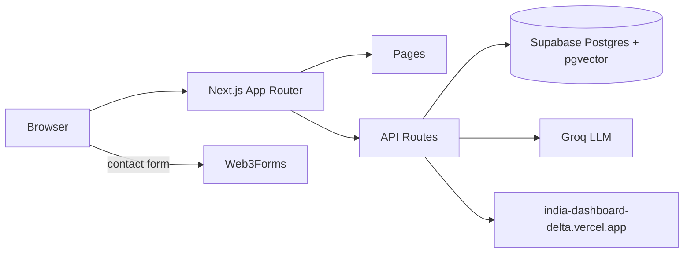

# Aditya Pandey — Portfolio

**Field Data · Clean Insights · Real Decisions.**

A tier-4 "extreme" portfolio built with **Next.js 15**, **React 19**, **Three.js (R3F)**, **Framer Motion**, **Supabase** (Postgres + pgvector), and **Groq** for a grounded RAG chat assistant.

[](https://nextjs.org)
[](https://react.dev)
[](https://www.typescriptlang.org)
[](https://tailwindcss.com)
[](https://supabase.com)
[](#license)

> Branch in active development: `v2-redesign`. Production-tracking branch: `master`.
>
> Status: `1.0.0`, `private: true`, no automated tests, no CI, **no LICENSE file yet**.

---

## Overview

This is the personal portfolio of **Aditya Pandey** — a data analyst, full-stack developer, and AI practitioner working as a Gandhi Fellow with the Piramal Foundation in Muzaffarpur, Bihar, India. The site combines a rich, interactive presentation of his field work (public health data, ASHA training, NQAS support, ODK pipelines) with two working features:

- **Ask AI** — a RAG chat assistant grounded in Aditya's resume and projects, streamed from Groq.
- **Contact** — a validated contact form delivered by Web3Forms with a Supabase fallback.

**Who it's for:** recruiters, collaborators, and public-health organizations evaluating Aditya for data analyst, full-stack, and public-health data roles.

**Value proposition:** field-grounded identity + interactive presentation + grounded AI + resilient contact pipeline.

## Screenshots and demo

Live site: https://aditya-pandey-beryl.vercel.app

Screenshots are not committed under a dedicated folder. To add them, drop the images into `public/screenshots/` and reference them from this section with a Markdown image tag (e.g. an image tag pointing at `public/screenshots/home.png`). The QA captures under `tasks/qa/` are working artifacts, not publishable assets.

## Features

### Core

- Landing page with a split-text hero, live-kernel telemetry panel, and impact metric blocks.
- Full project showcase with filters and case-study pages (`/work`, `/work/biharkaswaad`).
- RAG chat over Aditya's resume/projects (`/ask`), streamed word-by-word over SSE.
- Contact form with validation, delivered by Web3Forms from the browser with a Supabase fallback (`/contact`).
- Health field impact page (`/health`).
- "Vector RAG Terminal" home section with quick-query deep links into `/ask`.

### User-facing

- Light/dark theme toggle in the nav (persisted in `localStorage`).
- Command palette (Ctrl/Cmd+K).
- Boot/preloader screen on first paint (once per session).
- Per-route fade-in transitions.
- Sticky home section jump strip.
- Mobile header + bottom tab bar.
- 3D ambient background (desktop only).

### Not currently active (implemented in source, not mounted)

Visitor presence / "visitors online", live contact toasts, custom cursor ring, standalone terminal, 5-step field tour, easter eggs, 3D data sphere, and the live `/api/healthcare` indicators. See `docs/06-modules-and-features.md`.

### Technical

- Static generation for all 6 pages.
- Serverless API routes (Node.js runtime).
- Graceful degradation when env vars are missing (canned chat answers, `not-configured` contact).
- Security headers (X-Frame-Options, nosniff, Referrer-Policy, Permissions-Policy).
- Image optimization (AVIF/WebP).

## Technology stack

| Layer | Technologies |
|---|---|
| Framework | Next.js 15.3, React 19.1, TypeScript 5.8 |
| Styling | Tailwind CSS 3.4, PostCSS, Autoprefixer |
| Animation / 3D | Framer Motion 11.15, Three.js 0.174, @react-three/fiber 9.1.2, @react-three/drei 10.0.6 |
| Data / DB | Supabase (Postgres + pgvector + Realtime), @supabase/ssr 0.6.1 |
| AI | Groq (llama-3.3-70b-versatile), Vercel AI SDK 4.3.10, @ai-sdk/openai 1.3.12, @ai-sdk/react 1.2.9 |
| UI | lucide-react 0.474, Material Symbols |
| Utils | clsx 2.1.1, tailwind-merge 2.6.0 |
| Tooling | ESLint 9, TypeScript 5.8, Node 18.18+ (tested on 24) |

See `docs/02-technology-stack.md`.

## Architecture overview



Detailed: `docs/04-system-architecture.md`.

## Project structure

```
src/
├── app/          # routes + API handlers
├── components/   # motion, projects, providers, realtime, sections, three, ui, work
├── hooks/        # theme, toaster, easter eggs, scroll, live status
├── lib/          # constants, env, rag, supabase clients, data, utils
└── scripts/      # seed-kb.mjs, seed-knowledge-base.mjs
supabase/         # schema.sql, migrations/
knowledge-base/    # resume.md (RAG source)
docs/             # technical documentation
```

Full tree: `docs/03-project-structure.md`.

## Prerequisites

- Node.js 18.18+ (seed script needs Node 20.6+ for `--env-file`).
- npm.
- (Optional) Supabase project, Groq key, Web3Forms key, embeddings provider.

## Installation and setup

```bash
git clone https://github.com/adityapandey2002/Portfolio.git
cd Portfolio
git checkout v2-redesign
npm install

cp .env.example .env.local
cp .env.example .env   # for seed scripts
# fill in values
```

### Supabase (optional)

1. Create a project at https://supabase.com.
2. Run `supabase/schema.sql` in the SQL Editor.
3. (Optional) Seed: `npm run db:seed` (writes `knowledge_chunks`) and/or `npm run seed-knowledge-base` (prints JSON for `knowledge_base`).

### Run

```bash
npm run dev        # http://localhost:3000
npm run build && npm run start   # production
npm run lint
npm run typecheck
```

Detailed: `docs/11-installation-and-setup.md`.

## Environment variables

| Variable | Required | Purpose |
|---|---|---|
| `NEXT_PUBLIC_SUPABASE_URL` | For Supabase | Project URL |
| `NEXT_PUBLIC_SUPABASE_ANON_KEY` | For Supabase | Anon key |
| `SUPABASE_SERVICE_ROLE_KEY` | For server writes | Service role key (server-only) |
| `WEB3FORMS_ACCESS_KEY` | For email | Web3Forms access key (public by design — sent from the browser) |
| `GROQ_API_KEY` | For live chat | Groq API key |
| `EMBEDDINGS_API_KEY` | Optional | Embeddings provider key (or `OPENAI_API_KEY`) |
| `EMBEDDINGS_BASE_URL` | Optional | Embeddings base URL (default OpenAI) |
| `EMBEDDINGS_MODEL` | Optional | Embeddings model (default text-embedding-3-small) |

Full list and defaults: `docs/10-configuration-and-environment.md`. Never commit real secrets; `.env` is gitignored.

## Running the application

See Installation above. Dev server at http://localhost:3000.

## API documentation

| Method | Route | Purpose |
|---|---|---|
| POST | `/api/ask` | RAG chat (SSE stream) |
| POST | `/api/contact` | Contact form storage fallback (Supabase) |
| GET | `/api/healthcare` | Healthcare indicators proxy |

Detailed contracts: `docs/08-api-documentation.md`. Note: `/api/chat`, `/api/messages`, `/api/presence/*`, and `/api/status` are referenced in older docs/code but are **not implemented**.

## Database

Supabase Postgres + pgvector. Two schema files exist (`supabase/schema.sql` V2 and `supabase/migrations/0001_init.sql` V1) with differing table names — see `docs/07-database-documentation.md` and `docs/18-maintenance-and-troubleshooting.md`. V2 tables used by the app: `contact_submissions`, `knowledge_base`.

## Testing

No automated test suite. Quality gates:

```bash
npm run typecheck   # passes
npm run lint        # passes (3 font warnings)
npm run build       # passes (9 routes)
```

See `docs/13-testing-and-quality.md`.

## Deployment

Vercel (framework auto-detected as Next.js). Add all env vars from `.env.example` in Project → Settings → Environment Variables, then deploy. Update `metadataBase` in `src/app/layout.tsx` for a custom domain.

See `docs/14-deployment-and-infrastructure.md`.

## Documentation

Index: `docs/README.md`.

| Doc | Topic |
|---|---|
| `docs/01-project-overview.md` | Overview |
| `docs/02-technology-stack.md` | Tech stack |
| `docs/03-project-structure.md` | Structure |
| `docs/04-system-architecture.md` | Architecture |
| `docs/05-application-workflows.md` | Workflows |
| `docs/06-modules-and-features.md` | Modules/features |
| `docs/07-database-documentation.md` | Database |
| `docs/08-api-documentation.md` | APIs |
| `docs/09-authentication-and-authorization.md` | Auth |
| `docs/10-configuration-and-environment.md` | Config/env |
| `docs/11-installation-and-setup.md` | Setup |
| `docs/12-development-guide.md` | Dev guide |
| `docs/13-testing-and-quality.md` | Testing |
| `docs/14-deployment-and-infrastructure.md` | Deployment |
| `docs/15-security-documentation.md` | Security |
| `docs/16-error-handling-and-logging.md` | Errors/logging |
| `docs/17-integrations-and-third-party-services.md` | Integrations |
| `docs/18-maintenance-and-troubleshooting.md` | Maintenance |
| `docs/19-performance-and-scalability.md` | Performance |
| `docs/20-future-improvements.md` | Future work |
| `docs/AI_AGENT_CONTEXT.md` | AI agent context |
| `docs/diagrams/*` | Diagrams |

## Contributing

No formal `CONTRIBUTING.md` exists (proposed guidelines):

1. Branch from `v2-redesign`.
2. Run `npm run typecheck`, `npm run lint`, `npm run build` before opening a PR.
3. Keep content in `src/lib/data/*`; magic numbers in `src/lib/constants.ts`.
4. Do not commit secrets or `.env`.
5. Preserve existing conventions and do not change business logic in docs-only changes.

## License

No `LICENSE` file is present in the repository. The license has not yet been specified. (Do not assume a license.)

## Acknowledgements

- Next.js, React, Tailwind CSS, Framer Motion, Three.js / React Three Fiber.
- Supabase (Postgres, pgvector, Realtime).
- Groq (LLM inference).
- Web3Forms (contact delivery).
- lucide-react, Material Symbols.

## Contact and support

- Email: adityapandey.adu@gmail.com
- Work email: aditya.pandey@piramalswasthya.org
- Phone: +91 8601862114
- GitHub: https://github.com/adityapandey2002/
- LinkedIn: https://www.linkedin.com/in/aditya-pandey-a-fellow/
- Live site: https://biharkaswaad.in/

Repository: https://github.com/adityapandey2002/Portfolio.git
