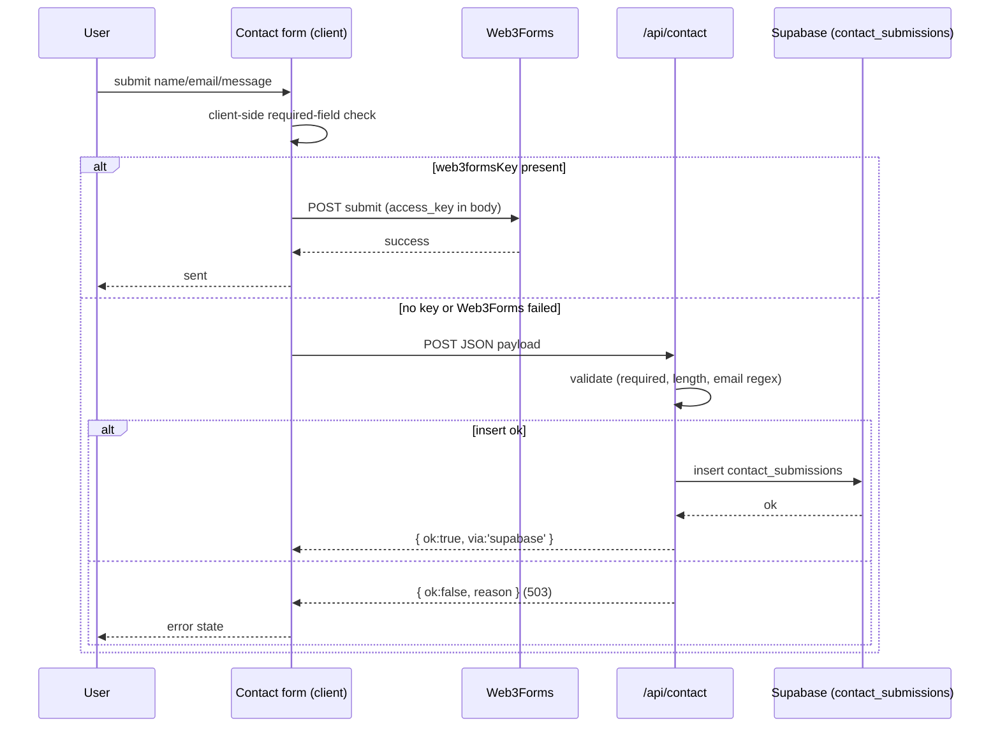

# 05 — Application Workflows

## Home page (`/`)

`src/app/page.tsx` composes: Hero → About → HomeJumpNav → Experience → SelectedSystems → Education → Pipeline → AiTerminal → Contact → Footer.

- Hero renders the split-text headline, an eyebrow badge, three CTAs, and a "Live Kernel" telemetry panel.
- `Experience` reads `src/lib/data/experience.ts`; `Contact` reads `src/lib/data/profile.ts`.
- `HomeJumpNav` is a sticky section strip.
- `AiTerminal` is a terminal-styled section whose quick-query buttons deep-link to `/ask`.
- `Contact` renders the validated contact form.
- `Footer` renders links and credits.

## Work page (`/work`)

`src/app/work/page.tsx` (1,923 lines) is a self-contained page that renders the project showcase with `WorkFilterBar` (desktop) and `WorkMobile` (mobile). `/work/biharkaswaad` is a dedicated case-study page built from `src/components/projects/BiharKaSwaadCase.tsx`.

> Note: `src/lib/data/projects.ts` and the `ProjectCard`/`ProjectGrid`/`WorkProjectCard` components are **not** used by the current `/work` page — the page hardcodes its project content inline.

## Ask page (`/ask`)

`src/app/ask/page.tsx` renders `AskTerminal` + Footer. `AskTerminal.tsx` presents suggestion chips, topic cards, and a terminal input that POSTs to `/api/ask` and renders the SSE stream. There is also an unused `AskClient.tsx` that uses `@ai-sdk/react` `useChat` against `/api/chat` (which does not exist) — not wired.

## Contact page (`/contact`)

Renders the Contact section + Footer.

## Health page (`/health`)

`src/app/health/page.tsx` renders a large health-system-strengthening narrative with metrics, WHO building blocks, field-mind panels, a telemetry feed, and a CTA to `/work`. It is self-contained JSX — it does not use the `HealthDashboard` / `health/*` / `pillars/*` components.

> The `/api/healthcare` endpoint is not currently consumed by any mounted component (see `docs/06-modules-and-features.md`).

## Contact form submission flow

Web3Forms is called **from the browser** because its free plan rejects server-side submissions. The API route is the storage fallback.



The `web3formsKey` prop is passed from the server components (`src/app/page.tsx`, `src/app/contact/page.tsx`) as `process.env.WEB3FORMS_ACCESS_KEY` and therefore ships to the browser. This is intentional — see `.env.example` and the comment in `src/components/sections/Contact.tsx`.

## Ask / RAG flow

```mermaid
sequenceDiagram
  participant U as User
  participant C as Ask UI
  participant R as /api/ask
  participant S as Supabase (knowledge_base)
  participant G as Groq
  U->>C: ask question
  C->>R: POST { question }
  R->>R: validate; check GROQ_API_KEY + Supabase config
  alt unconfigured
    R-->>C: SSE stream of canned fallback answer
  else configured
    R->>S: select content, embedding from knowledge_base
    R->>R: searchKnowledgeBase (cosine similarity, top 5)
    R->>R: buildContextPrompt
    R->>G: streamText (llama-3.3-70b-versatile)
    G-->>R: token stream
    R-->>C: SSE data: { text } lines
  end
```

## Healthcare data flow

`/api/healthcare` GET fetches 8 indicators in parallel from `https://india-dashboard-delta.vercel.app/api/rankings?indicator=<id>` with an 8s timeout each, using `Promise.allSettled`. Returns `{ fetchedAt, source, items, failed }`.

> Note: the only component that consumes this endpoint is `src/components/sections/HealthcarePanel.tsx`, which is reachable only from the unmounted `HealthDashboard`. The endpoint works, but no shipped page currently renders its output.

## Theme switching

1. Inline script in `layout.tsx` reads `localStorage.theme` before paint; adds the `dark` class if the stored value is `'dark'`.
2. `src/components/providers/ThemeProvider.tsx` adopts that class on mount and persists later toggles.
3. Tailwind `dark:` variants + the `--v2-*` CSS variables in `globals.css` respond to `html.dark`.

`globals.css` additionally defines four legacy `data-theme` palettes (`light`, `dark`, `sunset`, `cyberpunk`), but nothing sets `data-theme` at runtime — only light/dark are reachable.

## Boot / preloader

`PreloaderProvider` (mounted in `src/components/providers/Providers.tsx`) covers the first paint with a ~3.6s boot sequence showing a live percentage. It is skipped once per session (`sessionStorage['preloader-done']`) and skipped entirely for users who prefer reduced motion. Clicking or pressing the skip button dismisses it early.

## Desktop scale

At `min-width: 1024px` and above, `globals.css` applies `html { zoom: 0.8 }` and sets `--zoom-inv: 1.25` so that full-viewport section bands stay exactly one screen tall (commit `0f0cb4a`).

## Command palette

`CommandPaletteProvider` listens for Ctrl/Cmd+K, opens a searchable list of navigation + external links (Home, Work, Ask AI, Health, GitHub, LinkedIn, email), supports ArrowUp/ArrowDown selection and Enter to run.

## Visitors pulse / live toasts (defined, not mounted)

- `VisitorsPulse` and `LiveToasts` exist in `src/components/realtime/` but are not imported anywhere in the current tree. Presence API routes are missing. Treat as not functional.
