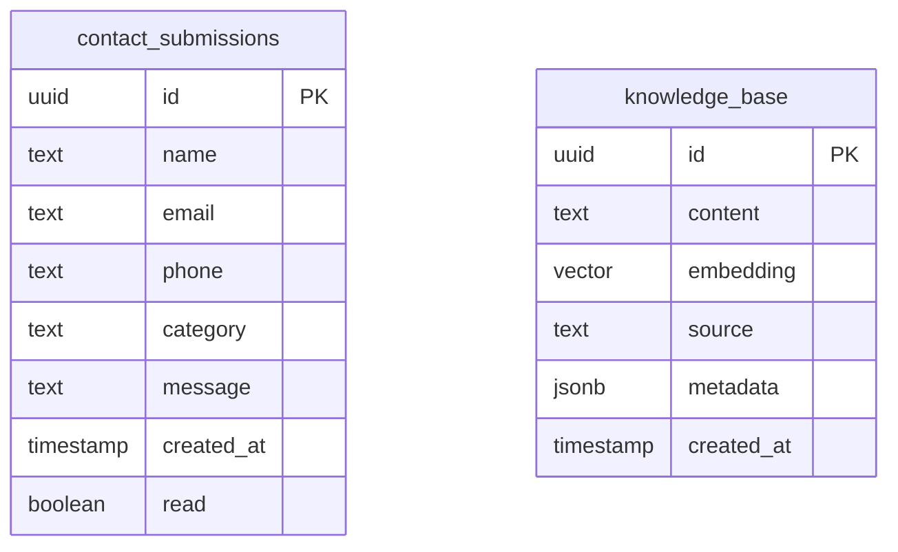
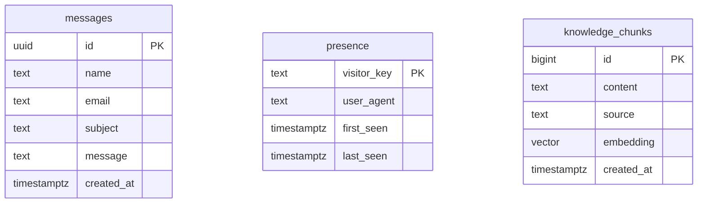

# Database ER Diagram

## V2 schema (authoritative for current app)



No foreign keys between tables.

## V1 (legacy) tables


```<|end|><|start|>write to=assistant<|channel|>analysis<|message|>Created file successfully: docs/diagrams/database-er-diagram.md