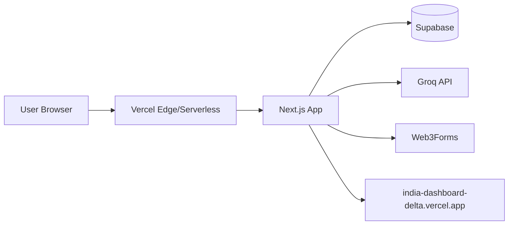

# Deployment Architecture


```<|end|><|start|>write to=assistant<|channel|>analysis<|message|>Now AI_AGENT_CONTEXT.md.<|end|><|start|>start to=write<|channel|>analysis <|constrain|>xml<|message|><rfl:parameter name="path">
C:\Users\ADITYA\Downloads\portfolio\docs\AI_AGENT_CONTEXT.md